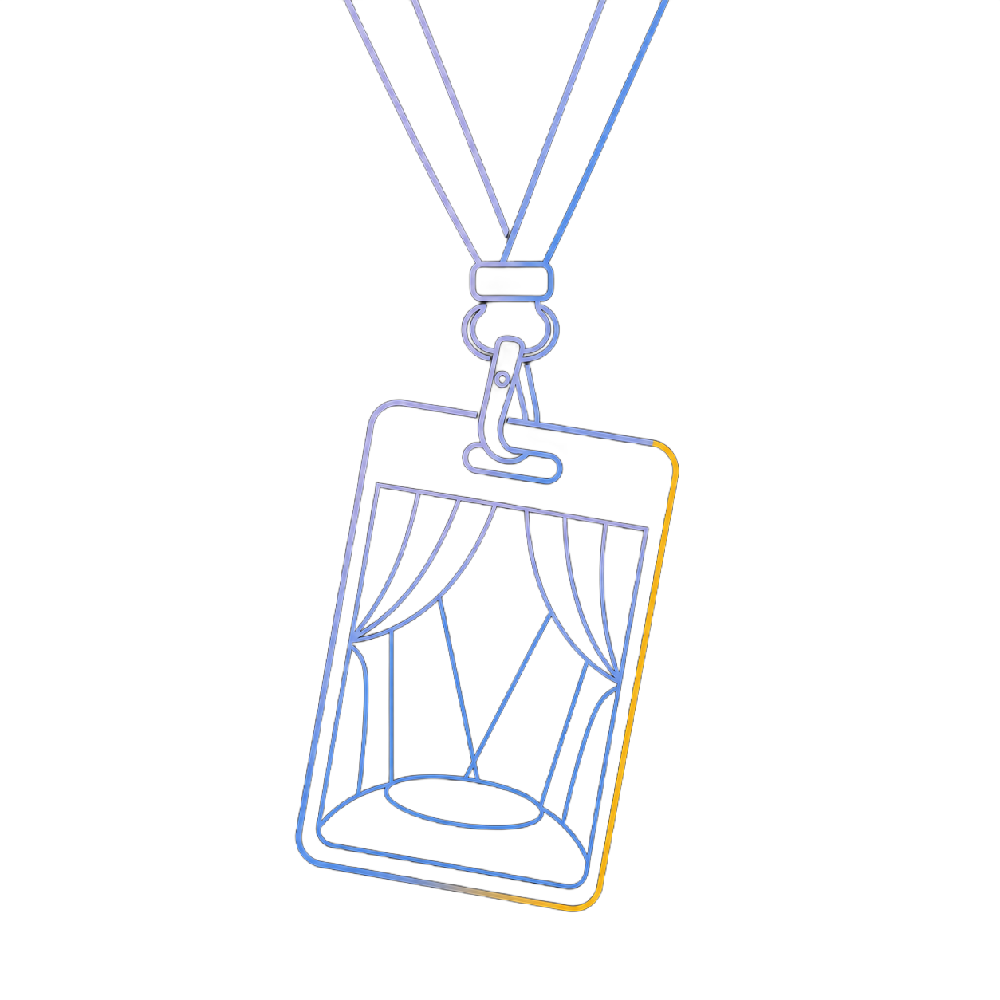
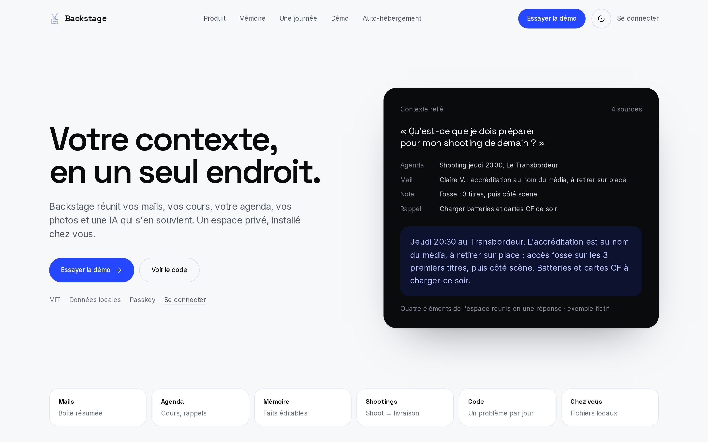

<div align="center">
  
  <h1>BACKSTAGE</h1>
  <p><strong>Second cerveau IA personnel — open source, auto-hébergeable.</strong></p>
  <p>
    Chat IA à mémoire persistante · Passkey (WebAuthn) · Streaming SSE ·
    Rappels synchronisés · Notifications push · PWA installable
  </p>
  <p>
    
    <a href="https://github.com/MattiaPARRINELLO/backstage/actions/workflows/ci.yml"></a>
    
    
    
  </p>
</div>



**BACKSTAGE** centralise dans une seule console ce qu'un assistant personnel
doit savoir faire : chat IA à mémoire longue, rappels, agenda, emploi du temps,
mails, watch-later et accréditations photo. Mono-utilisateur, passkey, données
JSON locales, installable et utilisable hors-ligne.

> _Un bon outil personnel, c'est comme une bonne photo : si tu remarques
> l'interface avant l'intention, c'est raté._

## Démarrer

```bash
git clone https://github.com/mprnl/backstage.git
cd backstage
bun install && bun run setup:dev && bun dev
```

Puis ouvrir [http://localhost:3000/api/auth/dev-login](http://localhost:3000/api/auth/dev-login) :
le mode `setup:dev` n'exige ni clé IA (`AI_PROVIDER=mock`) ni passkey
(`DEV_AUTH_BYPASS=true`). Les deux sont ignorés en production.

Installation complète, Docker, variables d'environnement et déploiement cPanel :
[`docs/installation.md`](docs/installation.md) et
[`docs/self-hosting.md`](docs/self-hosting.md).

## Trois portes d'entrée

| Tu veux… | Lis |
| --- | --- |
| **Comprendre le projet et ton parcours de lecture** | [`docs/README.md`](docs/README.md) — point d'entrée unique, trois parcours chronométrés |
| **Comprendre le code** | [`docs/architecture.md`](docs/architecture.md) et [`docs/contributing/code-map.md`](docs/contributing/code-map.md) |
| **Contribuer** | [`CONTRIBUTING.md`](CONTRIBUTING.md) et [`docs/contributing/premiere-pr.md`](docs/contributing/premiere-pr.md) |

## Ce que le projet assume

- **Mono-utilisateur** : un compte, une passkey, pas de notion d'équipe.
- **Pas de base de données** : fichiers JSON, écritures atomiques, backups.
- **Une seule couleur d'accent, deux thèmes** : la couleur porte l'action, jamais
  la décoration. Système complet dans [`docs/design.md`](docs/design.md).
- **Petites PR** : un sujet, moins de 400 lignes, aide IA déclarée.

## Licence

[MIT](./LICENSE) © 2026 Mattia Parrinello — libre d'utilisation, de modification
et de redistribution, sans garantie.

Contact : [contact.mprnl@gmail.com](mailto:contact.mprnl@gmail.com) ·
[github.com/MattiaPARRINELLO](https://github.com/MattiaPARRINELLO)
