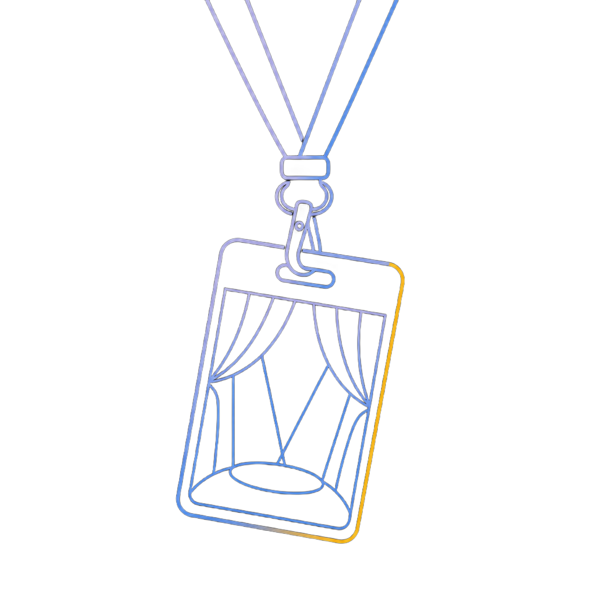
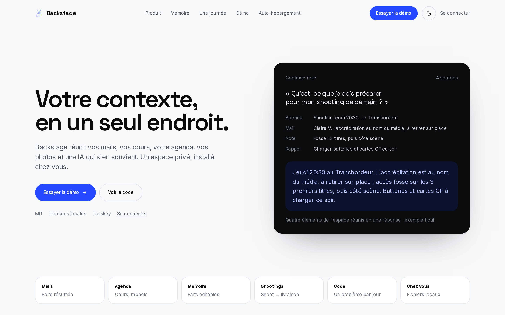
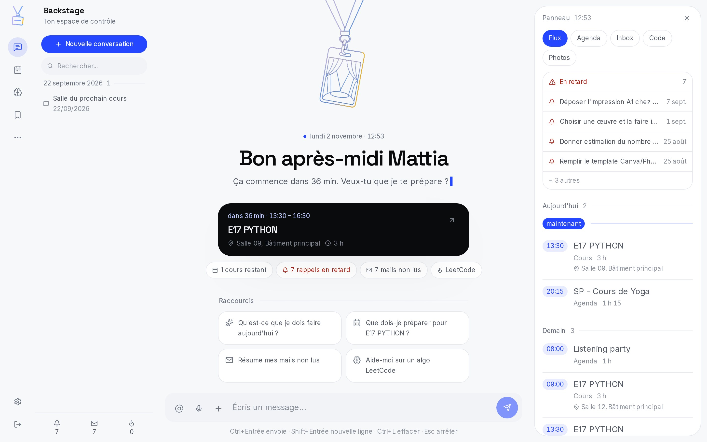
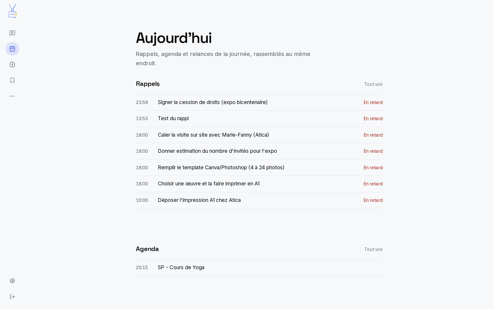
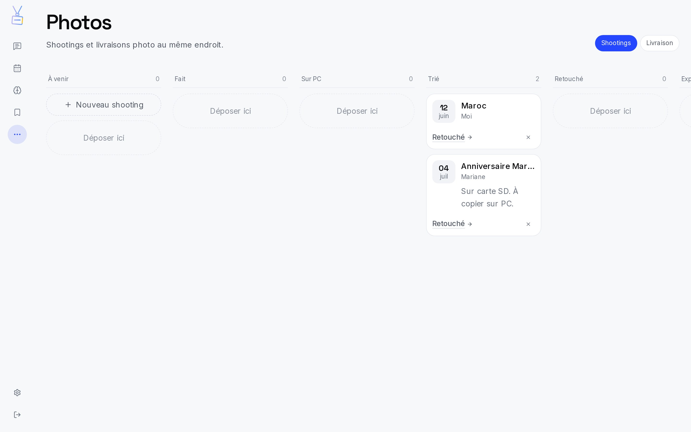

<div align="center">
  
  <h1>BACKSTAGE</h1>
  <p><strong>Second cerveau IA personnel — open source, auto-hébergeable.</strong></p>
  <p>
    Chat IA à mémoire persistante · Passkey (WebAuthn) · Streaming SSE ·
    Rappels synchronisés · Notifications push · PWA installable
  </p>
  <p>
    
    
    =20.9" src="https://img.shields.io/badge/node-%3E%3D20.9-3c873a?style=flat-square&logo=nodedotjs" />
    
  </p>
</div>



> _Un bon outil personnel, c'est comme une bonne photo : si tu remarques l'interface avant l'intention, c'est raté._

**Ce que c'est** — une PWA qui centralise chat IA, mémoire longue, rappels,
agenda, emploi du temps, mails, watch-later et accréditations photo dans une
seule console, claire ou sombre au choix, installable et utilisable hors-ligne.

**Auto-hébergement** — application **mono-utilisateur** (un compte, une passkey,
données en JSON local). Elle démarre avec deux variables obligatoires (un
endpoint IA compatible OpenAI et sa clé) ; Google, Microsoft et CESAR sont des
intégrations optionnelles.

## Sommaire

- [Déployer en 3 commandes](#déployer-en-3-commandes)
- [Ce que c'est](#-ce-que-cest) · [Stack](#-stack) · [Ce que je montre](#-ce-que-je-montre)
- [Les écrans](#-les-écrans) · [Décisions techniques](#-décisions-techniques-notables)
- [Trois problèmes réels](#-trois-problèmes-réels-et-ce-quils-mont-appris)
- [Installation](#-installation) · [Structure](#-structure)
- [Licence](#-licence) · [Santé du projet](#-santé-du-projet) · [Me retrouver](#-me-retrouver)

| Aspect | Détail |
| --- | --- |
| **Échelle** | 36 000 lignes · 25 pages · 38 routes API · 22 Server Actions |
| **Qualité** | 58 fichiers de tests (Vitest) + E2E Playwright |
| **Auth** | Passkey WebAuthn + JWT, OAuth Google & Microsoft |
| **Déploiement** | Docker (`compose.yaml`) ou build standalone Next.js (cPanel, VPS) |
| **Données** | Fichiers JSON avec écritures atomiques, verrous et rotation de backups |

### Déployer en 3 commandes

```bash
curl -fsSL https://brain.mprnl.fr/install.sh | bash
```

Ou à la main :

```bash
git clone https://github.com/MattiaPARRINELLO/backstage.git && cd backstage
cp .env.example .env.local && bun install && bun run setup
docker compose up -d --build     # http://localhost:3000
```

Le script d'installation ([`scripts/install.sh`](scripts/install.sh)) vérifie les
prérequis, clone le dépôt, installe les dépendances, génère les secrets locaux et
démarre l'app (Docker, ou `--node`). Il ne fait rien d'autre : aucun `sudo`,
aucune donnée envoyée nulle part.

📘 Guide complet (variables, HTTPS, backups, cPanel) : [docs/self-hosting.md](docs/self-hosting.md)
· [docs/deploy-cpanel.md](docs/deploy-cpanel.md)

---

## 🧠 Ce que c'est

BACKSTAGE n'est pas un dashboard de plus. C'est un espace de travail unique où
l'IA conversationnelle, la mémoire persistante et les outils du quotidien (Gmail,
Calendar, LeetCode, concerts) se répondent entre eux.

- **Chat IA streaming** (OpenAI / Anthropic) avec raisonnement visible, appels d'outils en direct
- **Mémoire** : l'IA se souvient de faits, et tu peux les corriger, oublier, explorer
- **Rappels** natifs navigateur + brief quotidien automatique
- **Watch-later** : liens, articles, vidéos YouTube avec extraction d'aperçu (og:image)
- **Agenda & Mail** : intégration Google via OAuth
- **Accréditations** : gestion des accréditations photo concerts (suit mes shootings)
- **Recherche web** : Brave Search avec fallback DuckDuckGo (outils IA du chat)
- **PWA** : installable, fonctionne hors-ligne, service worker, manifest
- **Thèmes & accent** : clair ou sombre (suit le système, choix mémorisé), couleur d'accent réglable dans les paramètres

---

## 💻 Stack

| **Frontend** | **Runtime & données** | **Intégrations** |
| --- | --- | --- |
|  |  |  |
|  |  |  |
|  |  |  |
|  |  | -34a853?style=flat-square&logo=webauthn&logoColor=white) |

Bun pour le développement et le build ; le conteneur de production exécute le
build standalone sur Node 22.

---

## 🌟 Ce que je montre

| Le chat | La journée |
| --- | --- |
|  |  |
| **Le chat** — une question, quatre sources ramenées par l'IA dans une seule réponse | **La journée** — rappels, agenda et cours sur une page, sans quitter le flux |



- **Tout dans une seule vue** : chat à gauche, agenda / mail / LeetCode / mémoire à droite, aucune page qui coupe le flux
- **IA qui agit vraiment** : `fetch_page`, `search_web`, `remember_fact`, `add_reminder` — avec confirmation explicite avant toute action externe
- **Pensé pour le quotidien** : raccourcis clavier (`⌘K` palette, `?` aide), PWA installable, fonctionne en 3G
- **Un seul accent, deux thèmes** : la couleur choisie dans les réglages porte l'action et la sélection, jamais la décoration

➜ **[Voir le code en action](#-installation)** (clone + `bun dev`)

---

## 🖥️ Les écrans

Toutes ces pages sont privées (passkey) sauf la landing et la connexion.

| Route | Ce qu'elle fait |
| --- | --- |
| `/` | Landing publique : ce que fait le produit, la démo et l'installation en une commande |
| `/login` | Connexion par passkey (Face ID / Touch ID / clé de sécurité), aucune saisie de mot de passe |
| `/chat` | Le cœur : conversation IA en streaming, mémoire, outils, pièces jointes et panneau de contexte |
| `/today` | La journée : rappels, agenda, cours et relances du jour réunis |
| `/week` | La semaine : charge de travail en colonnes, avec les événements et les retards |
| `/focus` | Un minuteur de séance, avec les rappels mis en pause pendant le travail |
| `/photos` | Kanban des shootings photo et vue « Livraison » (galerie par état) |
| `/brain` | La mémoire de l'IA : faits éditables, catégories, filtres et graphe de relations |
| `/watch-later` | Liens, articles et vidéos à garder, avec aperçu et réorganisation |
| `/calendar` | Agenda Google en grille mensuelle, création et édition d'événements |
| `/reminders` | Rappels groupés par échéance, récurrence et synchronisation Microsoft To Do |
| `/gmail` | Boîte de réception résumée, lecture et envoi de mails |
| `/leetcode` | Progression LeetCode : série, activité, difficulté et rang |
| `/schedule` | Emploi du temps CESAR (semaine + synchronisation) |
| `/settings` | Modèles IA, accent, connexions Google/Microsoft, export et compte |
| `/search` | Recherche unifiée dans la mémoire, les mails, les rappels et le web |
| `/activity` | Journal d'activité de l'application et des actions de l'IA |
| `/demo-calls` | Console privée des appels de la démo publique (audit) |
| `/privacy` | Politique de confidentialité et portabilité des données |
| `/offline` | Page de repli servie par le service worker hors-ligne |

---

## ⚡ Décisions techniques notables

1. **Next.js 16 App Router + React 19** — Server Actions pour la mémoire et les rappels, Server Components pour les vues, streaming IA via Route Handler SSE
2. **`googleapis` → `google-auth-library`** — moins de surface, plus de contrôle sur les tokens et le refresh
3. **Cache client TTL + stale-while-revalidate** — pas de re-fetch agressif, données toujours fraîches sous 60s
4. **Service Worker maison** — pas de Workbox, stratégie `cache-first` pour le shell, `network-first` pour les API
5. **Manifeste + icônes PNG déclinées** — service worker maison, installable sur iOS et Android sans dépendre d'un générateur
6. **Pas de base de données** — pour l'instant, fichiers JSON + mémoire serveur. C'est personnel, c'est assumé.

> Un bon outil personnel, c'est un outil qu'on peut ouvrir à 2h du matin
> sans se demander si la dépendance de gauche va casser.

---

## 🧩 Trois problèmes réels, et ce qu'ils m'ont appris

Ce sont les bugs qui m'ont le plus coûté de temps — donc les plus instructifs.

**1. Un bundle edge qui embarquait le système de fichiers.**
Mon proxy d'authentification plantait au démarrage en production avec
`__import_unsupported is not defined`. La cause : un import **statique** de
`dotenv` dans `instrumentation.ts`, qui embarque `fs`, `path`, `os` et
`crypto` dans le bundle edge — alors qu'un runtime edge n'a pas de système
de fichiers. Corrigé par des imports dynamiques gardés par une condition
`NEXT_RUNTIME === "nodejs"`.
*Ce que j'en retiens : sur un runtime edge, ce que tu importes statiquement
finit dans le bundle, même si tu ne l'exécutes jamais.*

**2. Playwright fonctionnait en local, mort en production.**
La synchro de l'emploi du temps passait au green sur ma machine et plantait
une fois déployé. L'hébergement de prod est un cPanel en `--production`,
sans Chromium : toute solution Playwright y était condamnée. J'ai réécrit le
scraping en `fetch` HTTP pur (CSRF → login → skip CVEC → décodage JSON de
l'attribut HTML).
*Ce que j'en retiens : le meilleur test, c'est d'essayer sur la
production avant d'y déployer.*

**3. Une API qui répond HTTP 200 en échouant.**
Mes compteurs LeetCode affichaient quatre zéros. Trois erreurs distinctes :
les compteurs ne sont pas sur `/{pseudo}` (mais sur `/{pseudo}/solved`), un
pseudo inconnu répond **200** avec un tableau `errors` dans le corps, et
`ranking: 5000001` signifie « non classé », pas un numéro.
*Ce que j'en retiens : HTTP 200 ne veut pas dire succès, et un champ bien
nommé ne signifie pas ce qu'on croit.*

---

## 🚀 Installation

```bash
git clone https://github.com/MattiaPARRINELLO/backstage.git
cd backstage
bun install
cp .env.example .env.local
bun run setup            # génère AUTH_SECRET, SETUP_TOKEN, VAPID, WebAuthn
bun dev
```

L'app démarre sur [http://localhost:3000](http://localhost:3000).
`bun run setup` est idempotent : il ne réécrit jamais une valeur déjà présente.

**Premier login :** ouvrir
[http://localhost:3000/login?setupToken=…](http://localhost:3000/login) (le token
est dans `.env.local`). Il ne sert qu'une fois. En production, sans
`SETUP_TOKEN`, l'enregistrement est refusé (503) — volontairement.

### Variables d'environnement

Obligatoires : `NEXT_PUBLIC_API_URL`, `IA_API_KEY` (tout endpoint compatible
OpenAI), `AUTH_SECRET`, `WEBAUTHN_RP_ID` / `WEBAUTHN_ORIGIN`, `SETUP_TOKEN`.

| Var                         | Rôle                                                       |
| --------------------------- | ---------------------------------------------------------- |
| `NEXT_PUBLIC_API_URL`       | Base URL de l'API IA (endpoint compatible OpenAI)           |
| `IA_API_KEY`                | Clé API du provider IA                                     |
| `AUTH_SECRET`               | Signe les JWT de session (passkey + Google + Microsoft)    |
| `WEBAUTHN_RP_ID`            | Domaine de la passkey (`localhost` en dev)                 |
| `WEBAUTHN_ORIGIN`           | Origine WebAuthn (`http://localhost:3000` en dev)          |
| `SETUP_TOKEN`               | Bootstrap one-time du premier passkey (à retirer ensuite)  |
| `GOOGLE_CLIENT_ID`          | OAuth Google (Calendar + Gmail) — optionnel                |
| `GOOGLE_CLIENT_SECRET`      | OAuth Google                                               |
| `GOOGLE_REDIRECT_URI`       | Callback OAuth Google                                      |
| `MICROSOFT_CLIENT_ID`       | OAuth Microsoft (sync reminders → Microsoft To Do)         |
| `MICROSOFT_CLIENT_SECRET`   | Valeur du secret Microsoft (pas le Secret ID)              |
| `MICROSOFT_REDIRECT_URI`    | Callback OAuth Microsoft                                   |
| `OPENWEATHERMAP_API_KEY`    | Météo (brief quotidien, préparation concert)               |
| `BRAVE_SEARCH_API_KEY`      | Recherche web Brave (optionnel, fallback DuckDuckGo)       |
| `NEXT_PUBLIC_VAPID_PUBLIC_KEY` | Paire VAPID Web Push (notifications)                    |
| `VAPID_PRIVATE_KEY`         | Paire VAPID Web Push                                       |
| `VAPID_SUBJECT`             | Contact mailto pour Web Push                               |
| `CRON_SECRET`               | Protège `/api/cron/*` (obligatoire en prod)                |
| `CRON_BASE_URL`             | URL publique utilisée par les crons                        |
| `CESAR_USERNAME`            | Emploi du temps CESAR — optionnel                           |
| `CESAR_PASSWORD`            | Emploi du temps CESAR                                       |

Liste commentée : [`.env.example`](.env.example).

### Commandes

```bash
bun dev              # dev server
bun run build        # production build
bun run start        # production server
bun run setup        # génère les secrets locaux (.env.local)
bun run lint         # eslint (flat config)
bunx tsc --noEmit    # type-check
bun run test         # vitest (unit tests)
bun run test:watch   # vitest (watch)
bun run test:e2e     # playwright (e2e)
bun run analyze      # build + bundle-analyzer
bun run cron:reminders   # déclencheur reminders (scripts/cron-scheduler.ts)
bun run cron:daily-brief # déclencheur brief du matin
bun run reset:passkey    # reset des passkeys enregistrées
```

---

## 🗂️ Structure

```
app/
  ├─ page.tsx          # Landing publique (thème clair par défaut)
  ├─ login/            # Passkey (WebAuthn), carte centrée
  ├─ chat/             # Conversation IA + panneau de contexte
  ├─ today/ week/ focus/  # La journée : agrégat, semaine, minuteur
  ├─ photos/           # Kanban shootings + galerie de livraison
  ├─ brain/            # Mémoire : faits, filtres, graphe
  ├─ watch-later/      # Liens, articles, vidéos
  ├─ calendar/ reminders/ gmail/ leetcode/ schedule/  # Intégrations
  ├─ settings/         # Modèles, accent, connexions, compte
  ├─ search/ activity/  # Recherche unifiée, journal d'activité
  ├─ demo-calls/ privacy/ offline/ notif/  # Démo, pages publiques
  ├─ actions/          # Server Actions (22 domaines)
  └─ api/              # Route handlers (SSE chat, auth, google, cron, push…)
components/
  ├─ chat/             # ChatView, streaming, tool calls, accueil
  ├─ layout/           # AppShell, Chrome (rail), ContextPanel, FluxTimeline
  ├─ ui/               # Primitives React (Button, Card, Input, Pill, Toast…)
  ├─ widgets/          # Calendar, Gmail, LeetCode, Accreditations
  └─ landing/          # Sections de la landing
lib/
  ├─ storage-core.ts   # Moteur JSON : écritures atomiques, verrous, backups
  ├─ storage/          # CRUD par domaine (reminders, memory, concerts, gallery…)
  ├─ types/            # Types métier par domaine (ré-exportés via types.ts)
  ├─ ai-providers/     # Adaptateurs OpenAI et Anthropic
  ├─ chat-runs.ts      # Générations de chat survivant à la navigation
  ├─ cesar-client.ts   # Emploi du temps CESAR (fetch pur, sans navigateur)
  ├─ google-client.ts  # OAuth Google + refresh tokens
  ├─ microsoft-client.ts # OAuth Microsoft + Graph todo
  ├─ session-core.ts   # JWT session (Node fs)
  ├─ session-edge.ts   # JWT session (runtime edge, proxy)
  ├─ cache.ts          # TTL, SWR, optimistic updates
  ├─ daily-brief.ts    # Brief du matin
  └─ offline.ts        # IndexedDB + queue offline
public/
  ├─ sw.js             # Service worker
  ├─ manifest.json     # PWA manifest
  └─ icons/            # Icônes PWA (192, 512, apple-touch)
scripts/               # cron-scheduler, reset-passkey, setup (secrets locaux), QA
Dockerfile             # image auto-hébergeable (build standalone)
compose.yaml           # déploiement Docker prêt à l'emploi
docs/                  # architecture, self-hosting, deploy-cpanel, android-apk
app/globals.css        # Tokens + primitives .ui-* (système décrit dans DESIGN.md)
app/landing.css        # Styles de la landing, isolés sous .landing-page
```

---

## 📄 Licence

[MIT](./LICENSE) © 2026 Mattia Parrinello — libre d'utilisation, de modification
et de redistribution, sans garantie.

## 🩺 Santé du projet

- CI (GitHub Actions) : lint, typecheck, tests unitaires, build, e2e à chaque push
- [DESIGN.md](DESIGN.md) — le système visuel : tokens, typographie, composants `.ui-*`, motion
- [docs/architecture.md](docs/architecture.md) — les invariants techniques (chat, mémoire, CESAR, notifications)
- [docs/self-hosting.md](docs/self-hosting.md) — variables, Docker, HTTPS, backups
- [docs/deploy-cpanel.md](docs/deploy-cpanel.md) — procédure mutualisée + crontab

---

## 📬 Me retrouver

| Contact               | Lien                                                               |
| --------------------- | ------------------------------------------------------------------ |
| Email                 | [contact.mprnl@gmail.com](mailto:contact.mprnl@gmail.com)          |
| GitHub                | [github.com/MattiaPARRINELLO](https://github.com/MattiaPARRINELLO) |
| Portfolio développeur | [dev.mprnl.fr](https://dev.mprnl.fr)                               |
| Portfolio photo       | [photo.mprnl.fr](https://photo.mprnl.fr)                           |
| Instagram photo       | [instagram.com/mattia_jpeg](https://instagram.com/mattia_jpeg)     |
